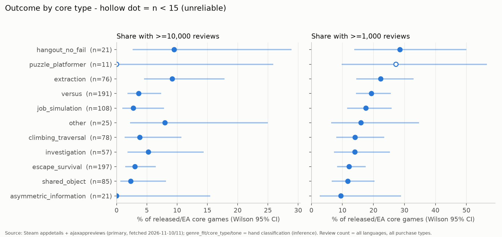
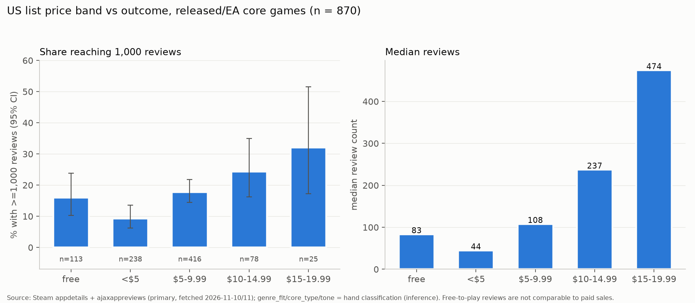
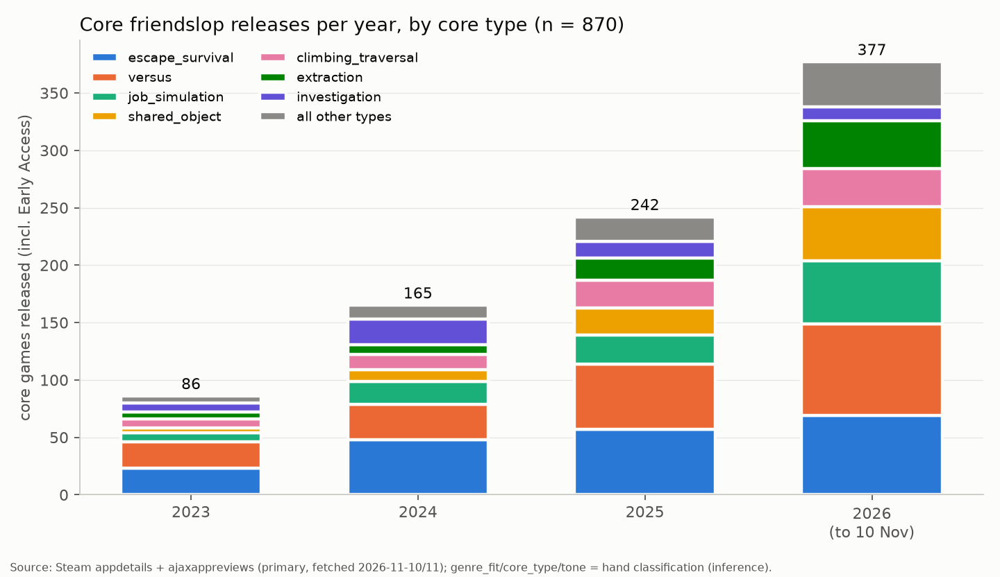
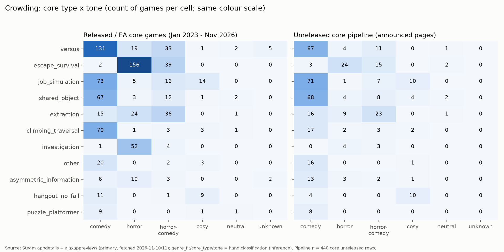

# Friendslop rewards the readable joke, then forgets it

**Research date:** data fetched 10-11 November 2026; report written 11 November 2026. **Scope:** cheap (≤$20), online, voice-chat-centred co-op and party games for 2-6 friends on Steam whose fun comes from physics, chaos or shared panic, first released January 2023 to November 2026, judged from the point of view of a 1-5 person team that wants to ship a small game rather than run a live service.

**How to read the tags.** Every number carries one tag. **[VP]** verified primary: read from a Steam endpoint (store, reviews, player counts, news) or from a developer's own channel, verbatim. **[DEV]** developer or publisher claim relayed by press and checked against the article. **[3P]** third-party estimate or model (SteamCharts, SteamSpy, AppMagic, Alinea, Solarsuit, GameDiscoverCo, How To Market A Game). **[INF]** inference by the research team. **[D]** a figure the research team computed from the tagged data above; every [D] figure is correlational. Where a note gives a date, it is shown. Local research files are linked with relative paths from this `reports` folder.

## Executive summary

Most friendslop games fail, and the ones that succeed share a short list of traits that are about readability and execution rather than about theme or price. **Roughly 1 in 10 core friendslop releases reaches 1,000 Steam reviews and about 1 in 40 reaches 10,000** [D]. The project's filtered set gives 16.2% and 4.0%, but that set excludes 1,291 released games with fewer than 10 reviews; adjusting for them gives about 9-11% and 2-3%, and Solarsuit's independent count is 8.7% for 2025-26 [3P] ([second-pass review](../research_notes/Friendslop%20genre%20market%20research/second_pass_review.md); [Solarsuit, 2026-10-28](https://analytics.solarsuit.games/data/posts/friendslop/friendslop-report-2026-10.pdf)). Supply has roughly quadrupled since 2023 (86 → 377 core releases a year) while the number of hits stayed flat, so per-game odds are falling [D]. Across 11 matched pairs of near-identical pitches, the hit always had a dated viral moment, almost always had fewer technical complaints, and made its goal and its first failure instantly legible; price, demos, festivals and update volume did not separate winners from losers. After launch, almost every game decays: content updates roughly double or triple the chance of a monthly player bump but **do not change where the player count sits three to five months later** [D]. Players' own reasons for quitting are mostly running out of novelty, friends drifting off and one difficulty wall that ends the group night. The clearest unmet demand is measured in mod downloads, not opinions: **in a quarter of modded games the most-downloaded mod simply raises the player cap** [VP counts], followed by mods that keep dead players involved, add text chat or per-player voice control, allow late join, and share upgrades across the team. The pipeline is piling into comedy job sims, comedy shared-vehicle games and comedy versus, while hangouts with a strong toy, comedy extraction, comedic investigation, asymmetric-information horror and third-person chaos stay thin. For a small team the implication is narrow: pick an under-filled cell, make the hook explain itself in ten seconds, make failure funny and player-caused, keep netcode boring, let the fifth and sixth friend in, give the dead something to do, and treat the launch month as the business.

## Eight hundred and seventy games after four filters

The genre was counted from Steam itself rather than from press lists, because press lists only name winners. A sweep of 22 flavour tags (Physics, Funny, Comedy, Horror, Party Game, Social Deduction, Voice Control and others) crossed with Online Co-Op or Co-op returned **9,856 apps** released from 2023 or unreleased [VP, Steam store search, 2026-11-10]. A traction and flavour rule cut that to 2,465, and 207 games from curated and pipeline lists that the sweep had missed were added, giving 2,672 rows [VP + curated]. Each row was hand-classified under a written codebook (version 2) as core, adjacent or out; blind re-coding agreed at κ 0.77 for genre fit, 0.85 for core type, 0.84 for tone and 0.81 for camera, though the same model family coded both passes, so κ measures rule consistency more than independent judgement [INF] ([layer1_classification](../research_notes/Friendslop%20genre%20market%20research/layer1_classification.md)). A game counts as **core** when it is ≤$20, pitched as online small-group play with shared chaos, physics or voice comedy, or co-op horror tension at the centre, has one of eleven core loops, and is not an MMO, mass PvP, battle royale, VR-only, single-player-first, public 1-vs-N, co-op combat or survival-craft game.

| Funnel step | Count | Tag |
|---|---|---|
| Tag-sweep union (22 flavour tags × Online Co-Op / Co-op; released ≥2023 or unreleased) | 9,856 | [VP] store search, 2026-11-10 |
| After re-check and traction/flavour rule | 2,465 | [VP]-derived |
| Plus curated and pipeline appids the sweep missed | +207 → 2,672 | curated + [VP] |
| Classified core / adjacent / out | 1,310 / 838 / 524 | [INF] |
| **Analysis set**: core, released or Early Access, first released 2023-01-01 to 2026-11-10 | **870** (656 released, 214 EA) | [INF] + [VP] |
| Core unreleased (pipeline) | 440 | [INF] + [VP] |
| Dropped by the sweep's ≥10-review floor before classification | 1,291 released games | [VP] `data\l1_filter_funnel.json` |

Two counting caveats run through everything below. First, the sweep only kept released games with at least 10 reviews, so the true flop rate is higher and the true hit rate lower than the filtered rates. Second, seven hits were missed by the tag sweep and entered only through curated lists (Schedule I and Fellowship, both later coded adjacent, plus WEBFISHING, Big Walk, Mage Arena, LOCKDOWN Protocol and Jump Space), so tag-based market sizing undercounts hangout, versus and sim-flavoured hits ([layer1_analysis](../research_notes/Friendslop%20genre%20market%20research/layer1_analysis.md)). Outcomes use the store's all-language review total [VP] as a ranking proxy, not a revenue estimate: the usual 30-60 sales-per-review rule [3P] may undercount this young audience, since GameDiscoverCo estimated about 180 sales per review for YAPYAP [3P] ([GameDiscoverCo, 2026-04-28](https://newsletter.gamediscover.co/p/how-yapyap-jammed-its-way-to-1-million)).

**The full spreadsheet** is `C:\Users\hasan\Documents\GD_MultiplayerGame\Friendslop_genre_dataset.xlsx` ([open](../Friendslop_genre_dataset.xlsx)), with sheets Genre (core) (1,310 rows), Adjacent (838), Out (524), a data dictionary, the theme-cluster rules and analysis tables A1-A10. The underlying classified file is `data\l1_classified.csv` (2,672 rows, 141 columns).

## Layer 1: the odds are low, falling, and barely moved by genre choices

### Base rates, with the second-pass correction

The filtered analysis set gives **16.2% (141 of 870) reaching ≥1,000 reviews and 4.0% (35) reaching ≥10,000; the median game has 81 reviews and 39.5% have fewer than 50** [D from VP]. Those figures exclude the 1,291 games under 10 reviews. If the same ~45% of those had been core, the rates become **about 9.7% for ≥1,000 (range 8.6-11.2%) and 2.4% for ≥10,000 (2.1-2.8%), with roughly 64% of games under 50 reviews** [D, INF on the core share] ([second-pass review](../research_notes/Friendslop%20genre%20market%20research/second_pass_review.md)). Solarsuit, using the same 1,000-review hit line on 288 tagged friendslop games released January 2025 to September 2026, finds 8.7% hits and 57% flops under 50 reviews [3P] ([Solarsuit](https://analytics.solarsuit.games/data/posts/friendslop/friendslop-report-2026-10.pdf)). Solarsuit is an indie studio that ships horror games and lists its own upcoming "Physics co-op · 1–4 players · Co-dev" title, Titan Hunters, so it has a stake in the genre; its numbers are modelled from Steam chart ranks ("usually within 30%" for revenue) [3P]. The working sentence for this report is therefore: **roughly 1 in 10 core releases reaches 1,000 reviews and about 1 in 40 reaches 10,000.**

### Core type, theme, tone, price, player count and camera

Differences between core loops are mostly smaller than the noise. **Extraction** (loot, carry, sell against a quota) has the highest hit rate, 9.2% at ≥10k (7 of 76) and 22.4% at ≥1k; **hangout with no fail state** has 28.6% at ≥1k on only 21 games; versus sits at 19.4% (n=191), job simulation 17.6% (108), climbing/traversal 14.1% (78), investigation 14.0% (57), escape/survival 12.2% (197, the largest type), shared object 11.8% (85) and asymmetric information 9.5% (21) [D]. In a logistic regression adjusting for price, tone, camera, player cap, publisher and half-year, no core type differs significantly from escape/survival on all rows; on the higher-confidence rows only shared object is lower (odds ratio 0.28, 95% CI 0.09-0.80) [D] ([layer1_analysis §4.1, §7](../research_notes/Friendslop%20genre%20market%20research/layer1_analysis.md)). Evidence strength: weak to moderate.

Tone matters more than theme, but less than it first looks. Comedy (18.3% ≥1k, n=405), horror-comedy (18.8%, 149) and cosy (18.8%, 32) outperform pure horror (11.9%, 270) [D]. The horror penalty is significant on all rows (OR 0.32) but disappears on higher-confidence rows (OR 0.54, CI 0.23-1.30), because obscure, low-information pages cluster in horror [D]. Theme clusters are too thin for strong claims; crime/heist/military (30.3% ≥1k, n=33), jobs/delivery/trades (24.0%, 25) and sci-fi/space (21.1%, 57) sit high, while homes/town/school (12.5%), haunted/paranormal (12.9%, the largest at 201 games) and backrooms (14.0%) sit low, all with overlapping intervals [D].

**Very cheap games did worst and $10-19.99 did not hurt.** The ≥1k rate is 9.2% under $5 (n=238), 15.9% free (113), 17.8% at $5-9.99 (416), 24.4% at $10-14.99 (78) and 32.0% at $15-19.99 (25) [D, current list price on 2026-11-10]. The under-$5 association survives stratification (Mantel-Haenszel OR 0.38 by publisher type × year; 0.32 self-published only), but on higher-confidence rows it shrinks to OR 0.58 with overlapping intervals [D] ([second-pass review §10](../research_notes/Friendslop%20genre%20market%20research/second_pass_review.md)). Solarsuit reports that games under $6 "sell better than their wishlist rank suggests, but usually have few wishlists" [3P], which points to scope and visibility: a low price is more likely a marker of a small project than a cause of failure.

Player cap shows one weak signal. Games capped at exactly 2 have the lowest ≥1k rate (7.3%, n=55); 3-4 players 15.9% (359); 5-6 14.9% (121); 7-8 23.2% (95); 9+ 22.4% (76) [D]. In the regression, 7+ players is borderline positive (OR 1.75, CI 1.00-3.08) and not significant on higher-confidence rows [D]. Camera looks decisive in raw counts (28 of 35 hits are first-person) but first-person (19.0% ≥1k) and third-person (18.5%) perform alike once unknown-camera pages, which are mostly obscure, are set aside (4.6%) [D]. Data quality itself tracks success: low-confidence rows reach ≥1k only 2.6% of the time versus 25.3% for high/medium rows [D], so any field with many "unknown" values partly measures how informative the store page is.

Two other associations are robust but not causal. Games with an outside publisher reached ≥1,000 reviews about twice as often (23.8% vs 13.9%; Mantel-Haenszel OR 2.17, stable at 1.8-2.3 across subsets), yet 24 of the 35 hits were self-published, and publishers sign games that already show traction [D] ([second-pass review §9](../research_notes/Friendslop%20genre%20market%20research/second_pass_review.md)). Early Access games did worse unadjusted (11.7% vs 17.7%) [D]. The has_demo field was dropped as evidence: Steam only shows demos still listed, and it misses 19 of 32 known pre-launch demos in the deep sample [D].

### Crowded and empty combinations

The released market is crowded in three places: first-person horror escape (156 horror escape/survival games, 10.9% ≥1k), comedy versus (131, 21.4%) and comedy climbing (70, 14.3%). **Comedy shared-object games are the warning cell: 67 released, only 9.0% reached ≥1k (CI 4-18%), and 68 more are announced** [D]. Comedy job simulation is similar in volume (73 released, 71 announced) with a better record (20.5%). The best-performing large cells are comedy extraction (33.3%, n=15, CI 15-58%) and horror-comedy extraction (25.0%, n=36, six hits) [D]. Most empty cells are empty because the combination is incoherent (cosy investigation, neutral hangout), not because of a market gap; the fillable thin cells are comedy escape/survival (2 released, 3 announced), cosy shared object (1 / 4), horror climbing (1 / 2) and fixed-camera extraction (1 / 2) [D] ([layer1_analysis §5.5](../research_notes/Friendslop%20genre%20market%20research/layer1_analysis.md)). The full grid is in the map section below.

### Year by year

Core releases ran **86 (2023), 165 (2024), 242 (2025) and 377 (2026 to 10 November)**, while hits (≥10k) by release year stayed at 7, 10, 11 and 7 [D]. Restricting to games at least 180 days old, the ≥1k share falls from 24.4% (2023) to 20.6% (2024), 19.0% (2025) and 14.4% (2026, n=146) [D]. Every adjacent pair of years has overlapping intervals, 2026 games have had less time, and these filtered rates overstate the true level for the reason given above, so the decline is moderate evidence. The direction is corroborated by Solarsuit's independent forecast of hit chances falling from about 1 in 10 (2025) to about 1 in 14 (2026) and 1 in 20 (2027) [3P, "a continuation of trends, not a model"] ([Solarsuit](https://analytics.solarsuit.games/data/posts/friendslop/friendslop-report-2026-10.pdf)). The tone mix is shifting too: comedy went from 42 releases in 2023 to 202 in 2026 while horror plateaued at about 80 a year, and 64% of the announced pipeline is comedy against 47% of released games [D]. The median paid list price has stayed at $6.99-$7.99 every year, and the share of free games fell from 23% (2024) to 7% (2026) [VP/D].

Zukowski argues the audience is "hungry", not saturated, because the combined CCU of 17 hand-picked hits peaked higher with each mega-hit (197k in December 2023, 281k in March 2025, about 366k in June 2026) [3P] ([How To Market A Game, 2026-07-30](https://howtomarketagame.com/2026/07/30/is-friendslop-saturated/)). Recomputed from his own chart data, the annual mean of that stacked CCU was 104k (2024), 131k (2025) and 138k (2026 to July): **nearly flat from 2025 to 2026 while core releases grew by about half** [D]. Both can be true: the hit audience is large and moves to each new hit, and per-game odds are falling. For a single small team, the per-game odds are the relevant number.

## Eighty games studied in depth, eleven of them in matched pairs

### How the 80 were chosen

The deep-study population was every core game first released between 1 January 2023 and 12 September 2026 (at least 60 days on sale), which left 744 games after removing 27 whose first release predates 2023 and 99 that were too young [D]. Three strata were defined by all-language reviews: **hits ≥10,000 (population 30, 25 selected), mid 500-9,999 (153, 25 selected) and flops under 200 with at least one effort signal (demo, outside publisher, curated listing, pipeline rank or Next Fest) and at least 10 reviews (155, 30 selected)**; the 200-499 band was not sampled. Seventy games were drawn at random within strata, proportional to core type, with a fixed seed (2026); one coverage swap ensured every core type appears at least twice; and 10 were swapped in as deliberate members of 11 hand-built matched pairs, keeping strata at exactly 25/25/30. Hits not drawn were Ale & Tale Tavern, The Headliners, Zort, Shift At Midnight and MECCHA CHAMELEON. The flop rule means the flops are "tried and failed" games, not abandoned asset flips. One-line reasons for every pick are in [deep_study_selection.md](../research_notes/Friendslop%20genre%20market%20research/deep_study_selection.md); per-game numbers are in `data\deep_study_comparison.csv` and [Deep_study_comparison.xlsx](../Deep_study_comparison.xlsx). Each game has a full profile (design, update history, price, launch path, team, developer statements, player-count cases) in [Deep study profiles.md](Deep%20study%20profiles.md), and the pairs are analysed side by side in [Matched pairs.md](Matched%20pairs.md).

Review themes were coded from up to 1,000 reviews per game (500 newest plus 500 most helpful for large games, a census for small ones) with multilingual keyword dictionaries; on an honest hold-out set the dictionaries scored precision 0.77 and recall 0.66, and 0.86 / 0.90 after a final revision [D] ([layer2_review_themes](../research_notes/Friendslop%20genre%20market%20research/layer2_review_themes.md)). Player curves come from SteamCharts monthly averages [3P]; 24 of the 30 flops have no SteamCharts data, so flop player comparisons rest on the current-players snapshot.

### The 80 games

Reviews and % positive are [VP] (Steam, 2026-11-10/11). Median hours at review and the technical-failure share of codable reviews are [D] from the review sample. Peak CCU and the month-6 / month-1 average-player ratio are [3P] SteamCharts. "–" means not available (SteamCharts does not track the game, or it is under six months old).

| # | Game | Stratum | Pair | Core type | Tone | Price $ | Reviews | % pos | Median h | Peak CCU | m6/m1 | Tech-fail % |
|---|---|---|---|---|---|---|---|---|---|---|---|---|
| 1 | Lethal Company | hit | P02 | extraction | horror-comedy | 9.99 | 511,826 | 96.9 | 14.0 | 239,369 | 1.27 | 9.2 |
| 2 | R.E.P.O. | hit | P03 | extraction | horror-comedy | 9.99 | 435,350 | 96.0 | 22.4 | 266,908 | 0.26 | 10.4 |
| 3 | PEAK | hit | P01 | climbing_traversal | comedy | 7.99 | 385,690 | 94.4 | 14.1 | 169,910 | 0.44 | 15.4† |
| 4 | Content Warning | hit | P08 | extraction | horror-comedy | 7.99 | 164,372 | 93.7 | 5.3 | 63,320 | 0.18 | 8.8 |
| 5 | Supermarket Together | hit | P05 | job_simulation | comedy | 0.0 | 101,350 | 94.3 | 8.3 | 47,731 | 0.51 | 8.7 |
| 6 | RV There Yet? | hit | P04 | shared_object | comedy | 7.99 | 91,202 | 90.1 | 9.5 | 56,960 | 0.26 | 18.2 |
| 7 | How to Fish | hit |  | other | comedy | 7.99 | 88,339 | 95.1 | 6.7 | 373,887 | – | 6.5 |
| 8 | WEBFISHING | hit | P11 | hangout_no_fail | cosy | 4.99 | 70,549 | 97.3 | 14.2 | 23,966 | 0.08 | 12.9 |
| 9 | Chained Together | hit | P07 | climbing_traversal | comedy | 4.99 | 65,230 | 89.5 | 5.2 | 92,186 | 0.08 | 6.5 |
| 10 | Liar's Bar | hit | P06 | versus | comedy | 6.99 | 56,599 | 89.5 | 4.1 | 109,419 | 0.08 | 18.2 |
| 11 | One-armed robber | hit |  | extraction | comedy | 0.0 | 54,546 | 91.3 | 5.1 | 10,993 | 0.45 | 6.2 |
| 12 | Big Walk | hit |  | hangout_no_fail | cosy | 19.99 | 47,512 | 94.7 | 11.6 | 46,224 | – | 17.4 |
| 13 | Gamble With Your Friends | hit |  | other | comedy | 7.99 | 26,960 | 89.7 | 4.5 | 24,666 | 0.54 | 6.0 |
| 14 | Bopl Battle | hit |  | versus | comedy | 9.99 | 26,263 | 97.2 | 12.0 | 2,175 | 1.32 | 5.3 |
| 15 | Demonologist | hit | P10 | investigation | horror | 19.99 | 24,621 | 84.8 | 9.4 | 8,693 | 0.27 | 18.5 |
| 16 | Mage Arena | hit | P09 | versus | comedy | 2.99 | 20,512 | 90.8 | 2.3 | 17,126 | 0.03 | 10.4 |
| 17 | LOCKDOWN Protocol | hit |  | versus | comedy | 9.99 | 20,134 | 85.9 | 12.2 | 9,318 | 2.94 | 10.9 |
| 18 | Nuclear Nightmare | hit |  | escape_survival | horror-comedy | 6.99 | 19,898 | 81.2 | 6.0 | 10,404 | 0.40 | 32.2 |
| 19 | Jump Space | hit |  | shared_object | neutral | 19.99 | 13,494 | 85.0 | 14.0 | 21,933 | 0.09 | 28.2 |
| 20 | PANICORE | hit |  | escape_survival | horror | 9.99 | 13,110 | 78.8 | 4.4 | 3,491 | 0.43 | 12.2 |
| 21 | Species: Unknown | hit |  | escape_survival | horror | 9.99 | 12,884 | 90.9 | 15.0 | 4,822 | 0.59 | 18.8 |
| 22 | Super Battle Golf | hit |  | versus | comedy | 12.99 | 12,230 | 92.9 | 7.2 | 20,395 | 0.29 | 7.4 |
| 23 | MIMESIS | hit |  | extraction | horror-comedy | 9.99 | 10,887 | 84.5 | 4.4 | 8,254 | 0.32 | 9.5 |
| 24 | YAPYAP | hit |  | extraction | horror-comedy | 9.99 | 10,494 | 83.0 | 4.0 | 14,719 | 0.14 | 10.9 |
| 25 | Fast Food Simulator | hit |  | job_simulation | comedy | 14.99 | 10,075 | 86.2 | 10.2 | 6,154 | 0.27 | 8.8 |
| 26 | Sneak Out | mid |  | versus | horror-comedy | 0.0 | 6,720 | 69.0 | 2.0 | 5,322 | 0.16 | 33.0 |
| 27 | Roadside Research | mid |  | job_simulation | comedy | 14.99 | 5,015 | 85.7 | 5.8 | 9,171 | 0.18 | 16.7 |
| 28 | Sledding Game | mid |  | hangout_no_fail | cosy | 7.99 | 3,472 | 96.1 | 4.5 | 3,213 | 0.11 | 10.6 |
| 29 | GRAIN ROT | mid |  | extraction | horror | 9.99 | 2,638 | 88.1 | 8.3 | – | – | 13.7 |
| 30 | The Escape: Together | mid |  | escape_survival | horror | 3.99 | 2,509 | 78.3 | 2.5 | 618 | 0.34 | 10.6 |
| 31 | Nine-Ball Roulette | mid |  | versus | horror-comedy | 3.99 | 2,482 | 88.2 | 5.7 | 2,146 | 0.37 | 9.4 |
| 32 | Sinister Night 2 | mid |  | versus | horror | 9.99 | 2,059 | 87.0 | 81.2 | 2,450 | 1.07 | 12.1 |
| 33 | Bogos Binted? | mid | P06 | versus | horror-comedy | 5.49 | 1,448 | 91.4 | 3.3 | 875 | 0.69 | 5.0 |
| 34 | Hospital 666 | mid |  | investigation | horror | 7.99 | 1,424 | 71.9 | 3.6 | 1,028 | 0.25 | 16.4 |
| 35 | Scam Line | mid |  | versus | comedy | 6.99 | 1,413 | 84.3 | 2.1 | 2,155 | 0.49 | 7.8 |
| 36 | Mama's Sleeping Angels | mid |  | escape_survival | horror-comedy | 9.99 | 1,378 | 93.6 | 3.5 | 476 | 0.20 | 5.8 |
| 37 | Climb The Backrooms | mid |  | climbing_traversal | horror-comedy | 4.99 | 1,256 | 80.7 | 3.2 | 262 | 1.00 | 10.8 |
| 38 | Crashout Crew | mid |  | job_simulation | comedy | 7.99 | 1,248 | 93.6 | 3.6 | 819 | 0.13 | 19.7† |
| 39 | BACKROOMS NO RETURN: Prologue | mid |  | escape_survival | horror | 0.0 | 1,232 | 32.2 | 0.4 | – | – | 30.6 |
| 40 | Darkwater | mid |  | shared_object | horror | 9.99 | 1,210 | 77.9 | 5.2 | 768 | 0.35 | 29.2 |
| 41 | Doll Impostor | mid |  | investigation | horror | 11.99 | 1,091 | 92.0 | 3.7 | 150 | 0.42 | 10.8 |
| 42 | Backroom Company | mid |  | extraction | horror-comedy | 8.99 | 923 | 85.4 | 3.6 | 2,444‡ | 0.58‡ | 17.1 |
| 43 | Backrooms: Extractions | mid | P08 | extraction | horror | 6.99 | 854 | 73.5 | 4.3 | 368 | 0.55 | 22.4 |
| 44 | Chained Wheels | mid |  | climbing_traversal | comedy | 4.99 | 792 | 70.3 | 3.1 | 847 | 0.12 | 22.4 |
| 45 | Log Riders | mid |  | shared_object | comedy | 4.99 | 785 | 70.2 | 1.8 | 596 | 0.28 | 12.6 |
| 46 | MAZEBOUND: Hunt, Gather, Run! | mid |  | escape_survival | horror | 9.99 | 731 | 81.9 | 6.5 | 475 | 0.14 | 17.2 |
| 47 | The Anomaly Project | mid |  | asymmetric_information | horror | 7.99 | 658 | 81.2 | 3.2 | 195 | – | 3.3 |
| 48 | Backrooms Media | mid |  | escape_survival | horror | 7.99 | 651 | 40.2 | 1.6 | – | – | 27.4 |
| 49 | Dumb Ways to Build | mid |  | job_simulation | comedy | 7.99 | 596 | 87.9 | 3.5 | – | – | 12.9 |
| 50 | Airport Security Sucks! | mid |  | versus | comedy | 7.99 | 591 | 84.8 | 3.4 | 685 | – | 10.8 |
| 51 | EXPEDITION TO THE BACKROOMS | flop |  | investigation | horror | 5.99 | 186 | 66.1 | 1.8 | – | – | 28.2 |
| 52 | Innchanted | flop |  | job_simulation | comedy | 19.99 | 175 | 82.3 | 4.0 | 124 | 0.29 | 14.0 |
| 53 | Super Shout Showdown | flop | P09 | versus | comedy | 7.99 | 152 | 86.2 | 2.5 | 204 | – | 15.7 |
| 54 | Sunset Summit | flop | P01 | climbing_traversal | comedy | 4.99 | 126 | 83.3 | 3.3 | 412 | – | 23.4 |
| 55 | WHERE the F$CK is my BITCOIN ⁉️ | flop |  | other | comedy | 6.99 | 120 | 58.3 | 1.4 | – | – | 16.9 |
| 56 | SpyHunt | flop |  | versus | comedy | 9.99 | 118 | 81.4 | 3.8 | – | – | 21.9 |
| 57 | S.E.M.I. – Side Effects May Include... | flop |  | puzzle_platformer | comedy | 7.99 | 113 | 85.8 | 2.1 | – | – | 16.7 |
| 58 | Foodslingers | flop |  | job_simulation | comedy | 9.99 | 106 | 97.2 | 4.5 | 13 | – | 23.3 |
| 59 | Cargo Duty | flop | P02 | extraction | horror-comedy | 0.0 | 103 | 68.9 | 0.6 | – | – | 6.7 |
| 60 | Treasure Hunters: Raid Together | flop | P03 | extraction | horror-comedy | 9.99 | 98 | 85.7 | 1.7 | 46 | – | 15.5 |
| 61 | Mortuar | flop | P10 | investigation | horror | 0.0 | 89 | 37.1 | 0.4 | – | – | 31.2 |
| 62 | Speed Crew | flop |  | shared_object | comedy | 9.99 | 88 | 98.9 | 2.8 | 23 | 0.31 | 10.3 |
| 63 | Don't Pull Me! | flop | P07 | climbing_traversal | comedy | 4.99 | 78 | 74.4 | 2.4 | – | – | 22.2 |
| 64 | Drive Together | flop | P04 | shared_object | comedy | 4.49 | 73 | 68.5 | 1.0 | – | – | 26.1 |
| 65 | OK Boomer | flop |  | escape_survival | horror-comedy | 7.99 | 70 | 71.4 | 1.0 | – | – | 16.4 |
| 66 | Cafe Crew Simulator: Prologue | flop |  | job_simulation | comedy | 0.0 | 64 | 82.8 | 1.0 | – | – | 15.4 |
| 67 | OCTOPinbs | flop |  | versus | comedy | 9.99 | 57 | 71.9 | 2.0 | – | – | 25.0 |
| 68 | Servonauts | flop |  | job_simulation | comedy | 14.99 | 54 | 81.5 | 2.9 | – | – | 16.7 |
| 69 | A Game About Penguins | flop | P11 | hangout_no_fail | cosy | 9.99 | 52 | 94.2 | 2.3 | – | – | 10.0 |
| 70 | Ticking Together | flop |  | shared_object | comedy | 4.99 | 46 | 95.7 | 2.5 | – | – | 19.6 |
| 71 | Co-op Kaiju Horror Cooking | flop |  | shared_object | horror-comedy | 7.99 | 43 | 74.4 | 2.1 | – | – | 30.0 |
| 72 | Tentacle Tango | flop |  | climbing_traversal | comedy | 14.99 | 39 | 100.0 | 2.0 | – | – | 2.6 |
| 73 | Out of Stock! | flop | P05 | job_simulation | comedy | 6.99 | 39 | 28.2 | 2.6 | – | – | 71.0 |
| 74 | Lamentations | flop |  | escape_survival | horror | 4.99 | 34 | 61.8 | 0.7 | – | – | 28.1 |
| 75 | RADIOACTIVE INC. | flop |  | escape_survival | horror | 1.99 | 30 | 56.7 | 1.0 | – | – | 7.4 |
| 76 | Nightfall Secrets | flop |  | escape_survival | horror | 5.99 | 27 | 29.6 | 0.6 | – | – | 25.0 |
| 77 | Bound To Fail | flop |  | climbing_traversal | comedy | 5.99 | 22 | 95.5 | 2.5 | – | – | 4.5 |
| 78 | Toy Scrappers | flop |  | versus | horror | 4.99 | 22 | 81.8 | 1.0 | – | – | 25.0 |
| 79 | We Escape Together | flop |  | puzzle_platformer | neutral | 0.99 | 13 | 0.0 | 0.7 | – | – | 30.8 |
| 80 | Keep It Contained | flop |  | asymmetric_information | comedy | 5.99 | 12 | 100.0 | 3.2 | – | – | 33.3† |

† Inflated by keyword false positives: PEAK's "crash" matches its in-game plane crash and Chinese 崩溃 ("frustrated"), so its true crash share is ~0.3% rather than ~2%, and its connection share ~3.5-4.3% rather than 5.1%; Crashout Crew's name matches `crash` (≥44 false hits, true crash share ≤10%); Keep It Contained's "connection" hits are an in-game cable and n=12 is too small to report. Scam Line's "dev abandoned" share is inflated by Russian "скам", the game's own mechanic. Pooled stratum results shift by well under a point [D] ([second-pass review §23](../research_notes/Friendslop%20genre%20market%20research/second_pass_review.md)). ‡ Backroom Company's player numbers look non-organic (monthly peaks pinned near 2,440 for four months, then a 92% cliff; 2.65 peak CCU per review against a 0.64 median) and are excluded from every player-count analysis [D/INF].

Across the strata, the medians tell the first story: hits' reviewers played a median 8.3 hours against 3.5 for mids and 2.1 for flops; 11.7% of hit reviews were written under two hours of play against 47.8% for flops; the technical-failure share is 10.4% / 12.9% / 20.7%; hits posted a median 45 Steam news items against 8.5 for flops; and the median list price is $9.99 / $7.99 / $6.49 [D]. Several of these (news count, playtime) are partly effects of being big rather than causes.

### Eleven matched pairs in brief

Each pair sets a hit against a game with nearly the same pitch that did much worse; in every pair the hit launched first, so first-mover advantage and streamer luck can never be separated from design ([Matched pairs.md](Matched%20pairs.md)).

**P01 PEAK vs Sunset Summit (climb a mountain together).** PEAK (385,690 reviews) launched into an empty niche via a four-day surprise launch; Sunset Summit (126) shipped 15 months later and its own developer says it was finished "after the success of PEAK" [DEV]. PEAK makes failure social (carry, bandage, revive at a statue, ghosts), while Sunset Summit's instant respawn removes those moments; Sunset Summit was cheaper and has more tech complaints (23.4% vs 15.4%).

**P02 Lethal Company vs Cargo Duty (moon-salvage crew).** Lethal Company's quota with loot that must physically reach the ship is readable; in Cargo Duty's only first-session video players never work out the goal ("I know it's two bucks but this can't be" [VP video]) and 86% of its reviews were written under two hours. The flop was cheaper and then free, so price argues against, and the pair mostly shows minimum viable depth.

**P03 R.E.P.O. vs Treasure Hunters: Raid Together (raid levels for valuables).** Same $9.99 price; R.E.P.O.'s fragile-physics grab beam turns every carry into a clip, while Treasure Hunters' first failures were getting stuck and a bug. Treasure Hunters did the full festival route (demo, four festivals, a free prologue, a 1.29M-view creator video [VP]) and still has 98 reviews: the best pair evidence that creator coverage alone does not convert.

**P04 RV There Yet? vs Drive Together (operate one vehicle; weak match).** RV's leaked store page went viral on TikTok and it released seven days after announcement on "its peak hype cycle" [DEV]; Drive Together had a Next Fest and 20k wishlists [DEV] but no viral moment. RV gives each player different jobs on a six-hour trip; Drive Together splits one car's controls so one laggy or weak player stalls everyone.

**P05 Supermarket Together vs Out of Stock! (co-op store sim).** Out of Stock! is the biggest execution gap in the study: 71% of codable reviews mention technical failure and online play was added only at release. Supermarket Together was free, scaled demand to up to 16 players and patched weekly; its player curve is the flattest of the hits.

**P06 Liar's Bar vs Bogos Binted? (deadly tabletop bluffing; hit vs mid).** Bogos Binted? is more polished (5.0% tech complaints vs 18.2%) and still reached only 1,448 reviews against 56,599. Liar's Bar has one instantly readable stake, a revolver, and went from about 2,000 to 113,798 CCU in 19 days through streamers [3P]; Bogos Binted? asks groups to learn five invented card games.

**P07 Chained Together vs Don't Pull Me! (roped-together climbing).** Same $4.99 price; Don't Pull Me! reviews call four-player play "super desyncd and laggy" [VP review], which breaks a game whose core verb is physical coupling. Chained Together built 40k wishlists and ran streamer betas; Don't Pull Me! shipped 25 months later with zero developer posts.

**P08 Content Warning vs Backrooms: Extractions (film horror for views; hit vs mid).** Content Warning's free 24-hour launch drew 6.2M claims [DEV] and its loop literally outputs a video of your friends (12.3% of positives call it clip-worthy [D]). The mid posted more updates (90 news items vs 41) and still lost, with bugs, repetition and "too short" complaints.

**P09 Mage Arena vs Super Shout Showdown (shout spells into the mic).** No first-15-minute difference: both use voice mis-recognition as the first laugh. Mage Arena was first, cost $2.99 against $7.99 and went viral on TikTok; the follower has more modes and accessibility options but needed bots to fill lobbies. Neither retains: Mage Arena has the steepest decay of any hit (m6/m1 0.03).

**P10 Demonologist vs Mortuar (Phasmophobia-style ghost identification).** The successful follower won on production value, many maps and 58 updates against two locations and one patch, at $19.99 versus free; Mortuar's player quit after one round because the game "has not told me like anything about what I'm meant to do" [VP video]. This is the counter-example showing a follower can win on depth.

**P11 WEBFISHING vs A Game About Penguins (cute-animal no-fail hangout).** A hangout's value is its population: WEBFISHING took the crowd first at $4.99, and Penguins, at $9.99 with more systems, added a feature nudging solo players into existing rooms, which signals empty lobbies. Penguins updated more and still sits at 52 reviews.

**Cross-pair synthesis.** Counted over 11 pairs: the hit had a dated viral moment the comparison lacked in 10 of 11 (not P10), and comparison games used Next Fest more (7 of 11, confirmed or likely), so festivals and demos did not substitute for a viral moment. The comparison game had more technical-failure mentions in 8 of 11, worst where online sync couples players physically. A readable goal and comedy from failure in the first minutes separated hits from clearly weaker followers in P02, P03, P07 and P10, was null in P09 and untested in P01, P05 and P11. Price was not a consistent lever: the cheaper game lost in four pairs and the dearer one in three, mattering only where the follower asked more for a thinner or emptier experience. Updates did not explain launches (the comparison game posted more in P08, P09 and P11). Hits more often give dead or downed players a role, and more often have one image that explains itself to a viewer (chain, revolver, fragile cart, a camera filming your friends). The pair design guarantees the hit launched first, so "being first wins" cannot be tested here.

## Twelve questions, answered with evidence strength

### 1. Design traits in hits that flops lack, and traits that do not explain success

Five traits recur in hits and are missing or weaker in flops. **A goal you can see** (a mountain, a cart, a chain, a quota terminal) is stated within about 20 seconds in hit first sessions without any tutorial, while abstract survive-the-timer or deduction goals in Cargo Duty and Mortuar never become clear ([layer3_first_15_minutes](../research_notes/Friendslop%20genre%20market%20research/layer3_first_15_minutes.md)). **A first failure that is the player's fault and visible to friends**: in hit group videos 0 of 15 first failures were an in-game bug or getting stuck, against 3 of 6 in flop group videos [VP videos, coded]. **Lower technical failure**: 12.9% of codable hit reviews versus 19.9% for flops (pooled), with bugs at a median 22.6% of flop complaint mentions against 14.1% for hits [D]. **A role for the dead or downed** (PEAK's carry and revive, R.E.P.O.'s head that must be carried back, Lethal Company's spectating), which comparison games mostly replace with instant respawn or nothing ([Matched pairs](Matched%20pairs.md)). **Repeatable runs rather than a finite course**: 18 of 25 hits are runs against 12 of 30 flops, and 12 of 30 flops are finite against 3 of 25 hits [D]; in Layer 1, runs reach ≥1k at 19.2% and sandboxes 24.6%, against 11.7% for finite games [D]. Developer testimony converges on the same mechanism: semiwork dropped R.E.P.O.'s cleaning loop because "there wasn't really anything in the gameplay loop that kept the players together" [VP, [semiwork video, 2025-04-11](https://www.youtube.com/watch?v=Gy1yGBron6A)], and Zeekerss called Lethal Company "a game about laughing at death" [DEV, [Push to Talk, 2024-01-19](https://www.pushtotalk.gg/p/how-lethal-company-sold-10-million-copies)].

Several traits appear in both hits and flops and do not explain success. "Fun with friends" is the top praise in every stratum (22-31% of positive reviews, median of games) and is the genre's entry ticket, not a differentiator [D]. Fast laughs, fast failures and on-screen confusion (a median 7-8 "what do we do" moments per 15 minutes) are equal across strata [VP videos, coded]. Solo support, proximity voice and difficulty scaling by player count exist in flops too (Treasure Hunters, Foodslingers, Out of Stock!, Kaiju Horror Cooking all scale) [VP patch notes]. Interdependence level does not separate strata (17 of 25 hits and 17 of 30 flops are "medium") [D]. Physics-chaos praise is, if anything, higher in flops on the recent review stream [D]. Price band, demos and Next Fest participation do not separate pairs.

**Evidence strength:** moderate for technical failure and visible goals (several independent measures agree); weak-moderate for dead-player roles and runs. **Correlation vs causation:** technical failure has a plausible reverse path (games that fail stop being patched, so bugs persist in later reviews), and flops are more often tiny teams, which confounds quality with resources. Public lobbies are a clear "effect of being big": 19 of 25 hits have them against 5 of 30 flops, but R.E.P.O., YAPYAP and others added them after selling millions [D/VP].

### 2. What made one of each matched pair succeed

The pair summaries above give the per-pair answer. The recurring, evidence-backed differences are a dated viral moment (10 of 11), fewer technical failures, especially in physics- or sync-coupled games (8 of 11), and a goal and first failure that read instantly (4 clear cases). Plausible but unmeasured: social failure states, a single self-explaining image, and an impulse price only where the hit was free or under $5 and the follower charged more for less. Evidence against: festivals and demos, update volume at launch, and price as a general lever. **Evidence strength:** moderate within pairs, but n=11, flop review samples are 38-147 codable reviews, and three flops have no first-session video. **Correlation vs causation:** every hit launched first and every hit had at least one stroke of luck or a stunt (Content Warning's free day, RV's leaked page, Lethal Company's late streamer wave), so none of these design differences can be shown to cause the launch outcome.

### 3. What separates games that still have players after six months

Almost nothing keeps players; the question is how slowly they leave. Among hits with data, the median month-6 / month-1 average-player ratio is about 0.29, ranging from 0.03 (Mage Arena) to 2.94 (LOCKDOWN Protocol) [D from 3P SteamCharts]. Hits keep a median 52% of month-1 average CCU at month 3 and 22% at month 12 (n=25 and 20) [D]. The ratios above 1 mostly reflect timing rather than retention: Lethal Company's virality arrived three to four weeks after launch (weekly peak CCU 611 → 43,268 [3P]), and LOCKDOWN Protocol's 1.0 release on 2025-11-18 [VP] came after its Early Access start; Bopl Battle's 1.32 was not explained in the notes. The steepest decays are novelty gimmicks and hangouts whose developers stopped posting (Mage Arena 0.03; WEBFISHING, Chained Together and Liar's Bar 0.08). By structure, repeatable runs hold slightly better than finite courses and sandboxes (median m6/m1 0.36, n=30; finite 0.28, n=7; sandbox 0.18, n=5) and interdependence makes no difference (0.27 high, 0.32 medium, 0.33 low) [D, small n].

Updates are where the evidence was tested hardest. Across all 80 games, **a month with a content-titled developer post had a 27.9% chance of a ≥20% player lift versus 11.3% in months without one, but 72% of update months produced no lift, and 43 of 100 lifts came with no content post at all, clustered in January, June, July and December** (Steam seasonal sales and school holidays) [D from VP news and 3P SteamCharts]. Three to five months after an update, games sit at a median 71% of their pre-update level, the same as months with no update (0.714 vs 0.707) [D]. So **updates spike but do not raise the baseline**: they buy re-activation events for lapsed groups, not a higher floor. AppMagic estimates day-30 retention around 3% for these games (Content Warning 3%, Phasmophobia 5.3%, Dead by Daylight 11.3%), which is one firm's model with no published method [3P] ([AppMagic, 2026-03-06](https://appmagic.rocks/blog/friendslop-steam-games-2025)).

The long-lived ancestors point to what does raise floors. Every game older than five years above about 5,000 average CCU has a persistent world, a Workshop or mod ecosystem, or a deep mastery curve; party games with an editor or Workshop (Golf With Your Friends, Pummel Party, Ultimate Chicken Horse, Human Fall Flat) sit higher and decay slower than those without [INF from 3P curves] ([layer3_ancestors_neighbours](../research_notes/Friendslop%20genre%20market%20research/layer3_ancestors_neighbours.md)). A realistic small-team long run is the "appointment game" pattern: a flat floor of roughly 300-2,000 average CCU with monthly peaks 4x the average, pulled out on game night [INF]. Mods are not sufficient: Lethal Company has 39,711 Thunderstore packages and still fell to about 2.5% of peak [VP/INF]. **Evidence strength:** strong for "updates do not move the baseline" (within-game before/after test across 80 games); weak for structural effects. **Correlation vs causation:** developers may time updates to slumps, which would bias the test towards finding a lift, making the null more convincing; developers also stop updating when players leave, so "abandoned games decay fastest" may be reverse causation.

### 4. Why friend groups stop playing

The direct evidence is 43 first-person quit statements (31 Steam posts and 12 Reddit comments across 21 games, collected by search, not sampled) in `data\quit_reasons.csv` ([layer3_communities_mods Q5](../research_notes/Friendslop%20genre%20market%20research/layer3_communities_mods.md)). Under a second, independent coding: **the most common reason was running out of novelty, about 4 in 10 (17 of 43, content exhaustion plus repetitiveness, stable across both codings); next came friends drifting away (7, about 1 in 6) and frustrating difficulty spikes (7-8, about 1 in 6, concentrated in two games)** [D]; toxic randoms (6), bugs (6), developer abandonment (4) and progression resets (4) follow. Representative data points: "we stopped playing it with my friends bc of the lack of the main goal. We pushed 150h... would easily hit 200 with some hard to obtain, endgame goal" (Lethal Company) [VP, [Reddit, 2026-09-29](https://www.reddit.com/r/lethalcompany/comments/1wsnhk5/who_else_misses_prime_lethal_company/pcrjm6w/)]; "we don't play it anymore because we all got bored of the same maps", from a group that has played Golf With Your Friends for years "because with the workshop there's always something new" [VP, [Steam, 2026-09-17](https://steamcommunity.com/app/4069520/discussions/0/762933999649722930/#c574927238287411343)]; RV There Yet?'s cave section produced four separate group-quit statements in one thread ("me and my friends got to cave... we havent played again since") [VP, [Steam](https://steamcommunity.com/app/3949040/discussions/0/669474588663694495/#c681859758980007145)]; and PEAK's Roots biome "got my group of friends to stop playing the game every night" [VP, [Reddit, 2026-09-12](https://www.reddit.com/r/PeakGame/comments/1we135j/community_question_what_biome_do_you_despise_in/p9akcsn/)].

Opinion is kept separate. Eighteen third-party explanations (people explaining *others'* departures) mostly blame novelty and moving to the next "slop" ("the gimmic got old. no amount of new content can really fix that") [VP quotes, opinion]. The useful contrast is that people explaining their *own* group's departure more often name concrete, fixable causes: a difficulty wall, no endgame goal, the same maps, a friend dropping out, toxic randoms, an unstable modpack, a progression wipe [INF]. A friend-group-specific pattern stands out: one frustrating section ends the night and the group does not reconvene. Analyst framing agrees on the shape: "Friendslop money is first-month money" [3P, Solarsuit]. **Evidence strength:** weak for the ranking (n=43, one Lethal Company thread supplies several quotes, four difficulty statements come from one RV thread), moderate for the headline. **Correlation vs causation:** these are self-reports; scheduling and life events are almost certainly under-posted.

### 5. The first 15 minutes in hits versus flops

Thirty-two YouTube first-session videos were coded from timed captions (11 hits, 5 mids, 8 flops) ([layer3_first_15_minutes](../research_notes/Friendslop%20genre%20market%20research/layer3_first_15_minutes.md)). On every measurable timing, hits and flops look alike: the goal is stated, the first laugh arrives and the first failure happens within about one to four minutes of first control in both (hits: goal +138 s, laugh +134 s, failure +100 s; flops: +80, +150, +41) [VP videos, coded]. Two findings survive the second-pass review. **Invite and connection friction shows up in hits too**: raw streams show 1.5-5 minutes of setup, and invite or join failures appear in 4 of 5 raw hit-group streams (Content Warning's fourth friend's invite failing until 03:30; RV's "Why can't I invite this?") [VP]. **No hit group played a formal tutorial; friends or in-world props taught the rules** (RV's manual and to-do note, Content Warning's whiteboard, R.E.P.O.'s emoji screen in the truck) [VP]. The qualitative differences are what kind of failure comes first (funny and player-caused in hits; a bug or stuck in half the flop group videos) and whether the confusion is about **how** (controls, extraction) or **what** (the point of the game). Cargo Duty's players asked at 01:43 whether that was "the whole game" [VP video]; Cargo Duty and Mortuar draw the clearest "no tutorial / don't know what to do" reviews under two hours [D]. The earlier headline that hits spend more time in a toy-filled hub (median 108 s vs 0 s) is dropped as a hit/flop difference because three of five flop videos were edited and may have cut a hub; toy hubs in hits remain a useful design observation, not evidence. **Evidence strength:** weak (28 of 32 videos coded by sub-agents without an agreement check; hit videos come from much bigger creators; survivorship in who uploads "part 1" videos).

### 6. How the games play with 2, 5+, solo, strangers and one much weaker player

The player-count sections of all 80 profiles were reviewed; most evidence is store text and patch notes, with review quotes rare ([Deep study profiles](Deep%20study%20profiles.md)).

**Exactly two players** is handled well where the game re-tunes the world: Big Walk lets the host pick a 2-, 3- or 4+-player version of the world, and a reviewer says it "truly reveals its essence when played as a duo" [DEV FAQ; VP review, 2026-08-24]; Species: Unknown reports half its week-1 sessions were duos [DEV]; Roadside Research and Out of Stock! tune scaling for pairs [DEV/VP]. It is handled badly where timers or encounters assume four: Co-op Kaiju Horror Cooking's timers left a pair "just barely scraping by" [VP, [Steam forum](https://steamcommunity.com/app/3139570/discussions/1/604161881226160485/)], PANICORE's military base is "impossible solo... even for duos" [VP review]. Designing *only* for two does not predict success: Log Riders and Chained Wheels (mids) and Tentacle Tango and We Escape Together (flops) are built for exactly two, and Layer 1 shows 2-cap games have the lowest ≥1k rate (7.3%) [D].

**Five or more** is where the demand is and where the testing is thinnest. About 30 of the 80 state a cap above 4, but only about 6 show balance or scaling evidence: Supermarket Together scales customer demand up to 16 [VP store], LOCKDOWN Protocol balances maps for 5-8 [DEV], Super Battle Golf is "balanced for up to 8 players, but supports up to 16 at your own risk" [VP], Big Walk becomes "more of a fun, chaotic mess" near 12 [DEV]. Caps above about 5 are often untested or crash-prone: Nuclear Nightmare's lobbies over 5 crashed until v1.0.9-1.0.10, MAZEBOUND's 5-8 "hasn't been fully tested", LOCKDOWN's developer found it "difficult for our small team to properly test... with 16 players" [DEV/VP patch notes]. Lethal Company, PEAK, Content Warning and RV There Yet? reach 5+ only through mods [VP]. Dead time grows with group size (Nine-Ball Roulette added ghosts and a First Blood mode for early deaths) [DEV].

**Solo** is the best-covered case: about 15 games show deliberate tuning (Fast Food Simulator's AI workers "to reduce the workload of solo players", Supermarket Together's hireable staff, Jump Space's BuddyBot, Demonologist's longer timers, Roadside Research's solo mode) [DEV]. Five hits openly treat solo as worse (MIMESIS reports 6.6% solo survival against 53.6% with four [DEV]; "boring solo but peak with friends" for Content Warning [VP review]). Notably, the "needs friends / bad solo" complaint correlates *positively* with rating (rho +0.46): it is how fans of good games add "only with friends" [D].

**Strangers** produce the dominant pattern of hits adding moderation after griefing (LOCKDOWN removed a cheat mode "players abused... in public sessions", RV added a ban button "to ban those trolls" and later a server browser, Super Battle Golf vote kick, Liar's Bar anti-cheat) and of flops and mids suffering empty lobbies instead (Penguins, Super Shout Showdown's bots, Mama's Sleeping Angels "kinda dead as far as public lobbies go") [VP/DEV]. PEAK is friends-only by design [VP]. WEBFISHING is the one hit built for strangers, and "fun with strangers" is a top-5 praise only there [D].

**One much weaker player** is the weakest-evidenced case: more than 45 sections found nothing. Super Battle Golf is the only game with a real catch-up system (rank-dependent item spawns, a "come-back points system", knockout immunity) [DEV/VP]; others use difficulty presets (LOCKDOWN's Training/Beginner because "new players are often lost", How to Fish's easy mode, Chained Together's checkpoint mode and a "3, 2, 1 Go!" sync key) or let strong players carry weak ones (PEAK, Big Walk) [VP/DEV]. The only review quote is negative: Chained Wheels' pair frustration, "friendship was lost" [VP review, 2026-07-09]; Drive Together's split controls make one weak player the whole car's problem [INF]. **Evidence strength:** moderate for solo and strangers, weak for 2-player, 5+ and mixed skill.

### 7. What players keep asking for that no game delivers, ranked

The ranking weights how many games show the demand, whether the evidence is behaviour (mod downloads) or talk (forum titles), and whether a base game already solves it. Mod downloads are cumulative and inflated by modpack installs, so they measure breadth of demand, not users.

| Rank | Request | Strongest evidence | Frequency | Strength |
|---|---|---|---|---|
| 1 | Bigger or flexible lobbies (5-8+), properly balanced | Lobby mod is the #1 game-specific mod in 15 of 61 modded games and present in 28; MoreCompany 27.1M, PEAK_Unlimited 4.2M, all five top RV mods [VP]; 32 forum threads in 20 games | ~35 games | Strong (behavioural), with the caveat that 81% of lobby-mod downloads are Lethal Company |
| 2 | Keep dead players involved | 19.9M downloads across 12 mods in 8 games (DeathHeadHopper 4.1M, DeadTTS 4.2M, SpectateEnemies 5.8M, GhostPing 0.5M) [VP] | 6+ games | Moderate-strong |
| 3 | A second evening that differs from the first, and a long-term goal | Novelty exhaustion is ~4 in 10 quit statements; new-content mods are the largest category (94.5M) [VP]; "lack of the main goal" quote | Every hit | Moderate |
| 4 | Text chat and per-player voice controls in a voice-centred genre | NiceChat 1.26M, PeakTextChat 179K, PEAK_Voice_Volume_Saver 258K, Big Walk's #1 mod is a per-player volume boost [VP]; 84 voice/mic threads in 31 games | ~31 games | Moderate |
| 5 | Late join / drop-in mid-session | LobbyControl 1.21M, Reconnect_Catchup 414K, LateJoinNow 281K, Virality 1.35M [VP] | 8+ games | Moderate (R.E.P.O.'s developers refuse it for security: "the game is not built for this" [VP]) |
| 6 | Shared team progression | R.E.P.O.'s shared-upgrade mod family about 2.4M, #1 R.E.P.O. mod on Nexus [VP]; 133 progression threads | 10+ games | Moderate-weak |
| 7 | UGC, workshop or custom maps | 146 modding/workshop threads in 31 games [VP titles]; Steam Workshop exists in only 3 curated games [VP]; Golf With Your Friends' workshop quote | 31 games | Moderate for demand; ancestors show editors raise floors |
| 8 | Mixed-skill tolerance (no single wall ends the night) | 7-8 of 43 quit statements; only one game with catch-up | Few games | Weak-moderate |
| 9 | Solo / bots | 61 threads in 33 games, but solo/bot mods total only 6.2K downloads [VP] | Vocal, small | Weak |
| 10 | Local split-screen | 28 threads in 17 games ("No Split Screen, No Buy" [38 replies]) [VP] | 17 games | Weak, costly |
| 11 | Safe public lobbies | 162 cheater/toxic threads in 44 games [VP titles] | 44 games | Moderate, but an ops burden |
| 12 | Crossplay and console | 111 threads in 38 games [VP titles] | 38 games | Moderate demand, out of small-team scope |

**No game in the sample ships natively** a flexible lobby above 4-6, drop-in late join, a built-in text and dead-player channel, per-player voice controls, a bot or solo mode and a UGC pipeline; each is separately modded into the leaders at million-download scale [INF from VP] ([layer3_communities_mods Q6](../research_notes/Friendslop%20genre%20market%20research/layer3_communities_mods.md)). **Correlation vs causation:** mods appear where games are big, so demand in small games is under-observed; that Shift At Midnight (3-player cap) and RV There Yet? (4-player cap) have lobby mods filling the whole top of their lists is the cleanest within-game signal.

### 8. Crowded versus empty mechanics, themes and tones, now and in the pipeline

Crowded now: first-person horror escape (156 horror escape/survival, 81 of them haunted-location), comedy versus (131), comedy climbing (70), comedy job sims (73) and comedy shared object (67) [D]. Crowded next: Layer 1's 440 core pipeline pages concentrate in comedy job sims (71 announced), comedy shared object (68) and comedy versus (67) [D, low-confidence codes]; a separate hand classification of 146 core unreleased titles in the pipeline note finds the same order (comedy job sims 34, especially medical and airline; shared vehicle 32 including raft and RV-likes; horror investigation and Backrooms 20; Lethal Company-style extraction 12) and visible waves of airline games, haystack games, gnome games, body-disposal games and "With Your Friends" titles [INF] ([layer3_pipeline_upcoming](../research_notes/Friendslop%20genre%20market%20research/layer3_pipeline_upcoming.md)). At least 25 core titles are dated November 2026 to January 2027, fighting for the same holiday streamer window [VP].

The thin cells, with a view on each:

| Thin cell (released / pipeline) | Nobody tried, or does it not work? |
|---|---|
| Comedy extraction (15 / 16; 33% ≥1k) | **Nobody tried enough.** Best large-cell record in the data; the extraction pipeline is mostly horror and Backrooms. |
| Hangout with no fail state (21 / 14; 28.6% ≥1k; cosy hangout 56% on n=9) | **Works, but needs a crowd and a toy.** WEBFISHING and Big Walk prove it; Penguins shows a late, toy-less copy starves. |
| Investigation × comedy (1 / 0) | **Mostly untried.** Content Warning and The Headliners show comedy works with horror tools; pure-horror investigation is crowded (52). Risk: the deduction loop is slow to read in clips. |
| Asymmetric information (21 / 13-19; 9.5% ≥1k) | **Tried, weak record.** Readable on Twitch only when the information gap is spoken aloud; BOMBANANA! (96% positive, 1,400 reviews [VP]) is the counter-signal, and a trio-comms wave is forming. |
| Comedy escape/survival (2 / 3) | **Nobody tried.** Horror owns this loop; horror-comedy escape already does 17.9% ≥1k on 39 games. |
| Horror climbing (1 / 2) | **Barely tried; plausible.** The one released horror climbing game is a hit-scale outlier in the theme table (haunted climbing: 2 released, 1 hit). |
| Cosy shared object (1 / 4) | **Untried; uncertain.** Shared object overall underperforms; cosy removes the fail-state stakes that drive the comedy. |
| Cosy versus / social deduction (1 / 0) | **Nobody tried; may not work.** Low stakes weaken bluffing tension; would need non-lethal but visible stakes. |
| Fixed-camera extraction (1 / 2) and third-person chaos co-op generally (~6 of 146 pipeline titles) | **Nobody tried recently.** Third-person performs like first-person (18.5% vs 19.0% ≥1k); fixed cameras read better muted in clips. |
| Shared-object horror outside tanks and submarines (3 / 4-7) | **Barely tried.** Darkwater (mid) and Jump Space (hit, neutral) show crewed vehicles can work. |
| Cosy investigation, neutral hangout, horror hangout | **Incoherent combinations,** not gaps. |

**Evidence strength:** strong as counts of what exists; weak as forecasts (pipeline coverage is partial and classification is unvalidated). **Correlation vs causation:** a high rate in a thin cell is small-n noise until proven otherwise.

### 9. What the ten-second clip of a hit looks like

On Twitch, a hit's most-viewed clip is usually a 5-60 second moment from a very large streamer: across 24 hit clips watched as eight muted frames each, 12 are large-streamer facecam reactions, 9 carry their meaning in voice or audio and are unreadable muted, 6 are mostly dark frames, 6 are a monster reveal, 5 a visible physics failure (fall, ragdoll, carry), 5 the death or harm of a friend, and only 8 are understandable muted in five seconds or less [VP observations, INF coding] ([layer3_clips_streamers](../research_notes/Friendslop%20genre%20market%20research/layer3_clips_streamers.md)). Two of R.E.P.O.'s top three clips do not show the game at all. The biggest gameplay Short found is Chained Together's IShowSpeed/Kai Cenat fall at 62.0M views in 18 seconds [VP]; the biggest YouTube numbers for MECCHA CHAMELEON (119.9M) and How to Fish (69.9M) are trailers that are most likely paid ad views [VP/INF]. Re-cutters add burned-in captions and stack the facecam over gameplay, so a key moment that is *visible* (a fall, a monster in a doorway, a body tumbling off a ledge) is easier to re-cut. Flop footage is not consistently less readable (Hold Your King's six-second palanquin-into-the-sea clip reads as well as hit clips); what differs is reach and repetition: hits show many creators in many languages returning months later, flops one big streamer trying it once [INF]. Developers say they designed for this: PEAK's lead noted "every playthrough seeming to be able to make a viral clip" and that adding a banana peel "would get us more views" [DEV, [GamesRadar+, 2025-12-23](https://www.gamesradar.com/games/survival/peak-put-friendslop-on-the-map-in-2025-but-neither-of-its-2-studios-expected-it-to-blow-up-we-were-ready-to-hit-the-launch-button-and-go-into-vacation-mode)]. Solarsuit argues "A clip is the only road to a mega-hit" [3P]. **Evidence strength:** weak; this describes what streamers clip after a game went viral, not the clip that started the spread (TikTok was not observable), and there is no flop sample large enough to compare.

### 10. What technical failures cost in reviews, and design choices that avoid them

**Refund rates are unavailable**: no source in the research gives a refund rate for any game in the genre, and the project has only refund *mentions*, about 1-2% of reviews, concentrated among reviewers under two hours [D]. What can be measured is the review cost. Technical-failure mentions appear in 12.9% of codable hit reviews, 15.6% of mid and 19.9% of flop reviews (pooled), and in 26.5%, 31.3% and 41.2% of negative reviews [D]. Reviews mentioning a technical failure are 60.6% positive against 84.3% for those without (n=6,414 vs 37,979) [D]. Across the 80 games, the tech-failure share correlates with store % positive at rho -0.51, and still at -0.26 when only positive reviews are counted, so it is not purely an artefact of negativity [D]. Under-two-hour reviewers complain about crashes, performance, refunds and missing settings; over-20-hour reviewers about bugs, balance, cheaters and developer abandonment (13.8% of negative >20 h reviews cite an abandoned developer) [D] ([layer2_review_themes](../research_notes/Friendslop%20genre%20market%20research/layer2_review_themes.md)). In the pairs, the worst failures are netcode in physics- or online-coupled games: Out of Stock! at 71% and Don't Pull Me!'s desync.

Design choices that the evidence associates with fewer failures: avoid making the core verb depend on two players' physics staying in tight sync across the network (rope and chain coupling is where desync broke Don't Pull Me!); cap the lobby at a size you have actually tested and raise it in a patch (Nuclear Nightmare's over-5 crashes, LOCKDOWN's untestable 16); treat voice recognition as a connection-complaint risk (Mage Arena's under-2-hour negatives: 16 of 63 mention connection [D]); ship friends-only lobbies first and add public lobbies with kick, ban and host permissions only when the population justifies it, as R.E.P.O. and PEAK did [VP/DEV]; and expect invite friction regardless, since it appears in hits too. PEAK disabled grass to fix a launch crash [DEV, [Inverse, 2025-06-27](https://www.inverse.com/gaming/peak-steam-landcrab-friendslop-update-interview-nick-kaman-pc)], and RV shipped five hotfixes in ten days [VP]: plan the first fortnight as a patch sprint. **Correlation vs causation:** complaint shares are mechanically linked to negativity, and games that fail stop patching; neither link shows that fixing bugs raises ratings, though the within-review gap is suggestive.

### 11. What small-team hits have in common

Hits made by 1-7 people are common in this genre. Solo: Lethal Company, WEBFISHING, Mage Arena and Bopl Battle [3P/DEV]. Two people: PANICORE (two brothers), Species: Unknown (two full-time) and Supermarket Together (two-person team) [DEV]. Three to seven: LOCKDOWN Protocol (about three siblings at first), RV There Yet? (prototype by four people in a week, about nine weeks total), Content Warning (five per Landfall's press kit, disputed), Big Walk (five full-time), PEAK (three Aggro Crab plus four Landfall, third-party summary), R.E.P.O. ("small team"; seven employees per a registry snippet) [DEV/3P] ([second-pass review §21](../research_notes/Friendslop%20genre%20market%20research/second_pass_review.md)). What they share: **none was a first game**; four (PEAK, RV, R.E.P.O., Murky Divers) were made by experienced teams escaping a long, draining project, and the solo hits came from developers with many prior small releases [DEV]. They found the core within a week ("during that week we kind of nailed the core, and it was already fun" [DEV, [GamesIndustry.biz, 2026-06-22](https://www.gamesindustry.biz/you-just-look-at-the-number-and-go-what-happened-the-developers-of-rv-there-yet-on-their-surprise-multi-million-selling-success)]), focused on one mechanic ("The whole game is just the client, the wall, and the stamina bar" [DEV, GamesRadar+]), shipped Steam-only, English-only and friends-only lobbies first, priced near $8, and relied on organic creator spread. Their stated regrets are all post-launch: "a mountain (hah) of bugs", "admin stuff", a bug reporter that fell over, burnout ("I feel like I'm burning out on Lethal Company" [DEV, Discord via GamesRadar+]). Teams warn against copying the model naively: "it takes years to build that type of relationship" (Nuggets) and "I can't say with confidence that the success is easily replicable" (Kaman) [DEV] ([layer3_developer_talks](../research_notes/Friendslop%20genre%20market%20research/layer3_developer_talks.md)). Short reveal-to-release windows worked only for teams with an existing audience or a Valve feature [INF]. **Evidence strength:** moderate for the shared traits, but this is survivor testimony: no source reports the team size or dev time of the flops, and team size is known for only 9 games in Layer 1.

### 12. Price, demo and launch-timing choices linked to results

**Price: weak link.** Under $5 is associated with about half the ≥1k rate, $10-19.99 with no penalty, and Solarsuit finds "no clear link between price and sales... friendslop games priced $12+ sold no worse than those at $7–8" at equal wishlist rank [3P]. Alinea, looking at three mega-hits only, estimates R.E.P.O. converted 38% of launch wishlists by day 7, RV There Yet? 34% and MECCHA CHAMELEON 21%, and warns that a base price above $10 "could severely blunt its launch velocity" [3P, modelled, survivors only] ([Alinea, 2026-07-17](https://alineaanalytics.substack.com/p/another-friendslop-challenger-enters)); these are not expected rates, since Solarsuit's whole-population view is that 7 of 10 friendslop games start lower in Top Sellers than a typical game at the same wishlist rank [3P]. Developers converge on about $8 with a lower launch entry ("eight bucks is still five bucks. It doesn't become ten bucks" [DEV, [Game File, 2026-01-07](https://www.gamefile.news/p/peak-interview)]). The pairs show price matters only when a follower charges more for a thinner or emptier experience.

**Demo and Next Fest: link cannot be measured.** The project's data cannot test whether a pre-launch demo helps, because Steam only shows demos still listed and misses 19 of 32 known pre-launch demos in the deep sample [D]. The often-quoted Zukowski finding ("no clear benefit either way") is about keeping a demo up *after* launch, not about pre-launch demos [3P, [GameDiscoverCo, 2026-02-13](https://newsletter.gamediscover.co/p/what-game-descriptions-tell-us-about)]. Descriptively, most hits had no demo or Next Fest (PEAK, Lethal Company, R.E.P.O., RV, Supermarket Together, Liar's Bar, Content Warning, Mage Arena, WEBFISHING), while 7 of 11 comparison games used Next Fest. Next Fest is becoming the genre's launchpad (about 17 co-op friend-group titles in the October 2026 top 50 against roughly 7 in June) but with falling payoff: the top-10% follower gain was +63 in October 2026 against +121 in June 2026 and +173 in October 2025, in a fest of 7,240 games [3P] ([GameDiscoverCo](https://newsletter.gamediscover.co/p/who-won-october-2026s-steam-next); [How To Market A Game, 2026-10-21](https://howtomarketagame.com/2026/10/21/how-sloppy-is-the-october-2026-steam-next-fest/)).

**Launch timing: moderate link, but as a consequence.** Solarsuit's short-cycle table shows a fast launch only works when wishlists are already strong (short cycle + strong wishlists: 4 of 7 reached the top 100 sellers; short + weak: 1 of 9), and "37 of 53 short-cycle friendslop games didn't gather wishlists and didn't even reach the top 1,000 in sales... Games get launched fast when their clip has already gone viral" [3P]. Wishlist rank predicts hits (friendslop games in the top 200 of the wishlist chart in their first month: 2 of 2 became hits; below #1,500: 6 of 85) [3P], partly tautologically. October is the third-worst launch month by median revenue for horror games with ≥$100k lifetime revenue [3P, [How To Market A Game, 2026-09-08](https://howtomarketagame.com/2026/09/08/horror-games-dont-need-to-launch-in-october/)]. **November review counts jump without a matching player rise about three times as often as in other months** (29.5% of November game-years show a ≥1.3x review spike vs 10.5% in other months, with no matching player rise), coinciding with the Steam Autumn Sale and Steam Awards nominations; treat November review spikes as seasonal, not a revival [D]. Lifts without updates cluster in sale and holiday months, but whether a game was actually discounted is not observable without SteamDB price history [D]. Publisher association (OR ~2) is robust and not causal.

## The map: where the released market and the pipeline sit

Each cell is **released / announced pipeline** core games, with the released ≥1k-review rate where n ≥ 15 [D from VP status and INF codes] ([layer1_analysis §5.1](../research_notes/Friendslop%20genre%20market%20research/layer1_analysis.md)).

| Core type | Comedy | Horror | Horror-comedy | Cosy |
|---|---|---|---|---|
| Escape / survival | 2 / 3 **empty** | 156 / 24 **crowded** (11%) | 39 / 15 (18%) | 0 / 0 |
| Versus | 131 / 67 **crowded** (21%) | 19 / 4 (16%) | 33 / 11 (18%) | 1 / 0 **empty** |
| Job simulation | 73 / 71 **crowded, doubling** (21%) | 5 / 1 | 16 / 7 (13%) | 14 / 10 |
| Shared object | 67 / 68 **crowded, weak** (9%) | 3 / 4 thin | 12 / 8 | 1 / 4 thin |
| Climbing / traversal | 70 / 17 **crowded** (14%) | 1 / 2 **empty** | 3 / 3 | 3 / 2 |
| Extraction | 15 / 16 (33%) **under-filled** | 24 / 9 (13%) | 36 / 23 (25%) | 0 / 0 |
| Investigation | 1 / 0 **empty** | 52 / 4 (13%) | 4 / 3 | 0 / 0 |
| Hangout, no fail | 11 / 4 | 0 / 0 | 1 / 0 | 9 / 10 (n<15) |
| Asymmetric information | 6 / 13 | 10 / 3 | 3 / 2 | 0 / 1 |
| Puzzle platformer | 9 / 8 | 0 / 0 | 0 / 0 | 1 / 0 |

By theme, the released crowding sits in haunted/paranormal escape (81 / 12) and investigation (40 / 3), backrooms escape (38 / 8), party/tabletop versus (40 / 21), and shop/food job sims (46 / 23); the pipeline is adding most to job sims in facility/office (11 / 16) and jobs/trades (7 / 15), and to shared-object vehicles/roads (11 / 16) and sea/water (7 / 10) [D]. Thin theme cells with some pipeline interest include job sims in crime/heist (2 / 7), shared object in facility (2 / 6) and crime (2 / 6), and climbing in haunted settings (2 / 3, one hit) [D]. Extraction is spread thinly across themes with no cluster above 12 released games, and crime/heist (4 / 0), jobs/trades (2 / 0) and sea/water (4 / 3) extraction are almost empty [D]. Camera adds one dimension: the pipeline is overwhelmingly first-person or unknown, with only about 6 of 146 hand-classified core unreleased titles in third person [INF].

## Ranked gaps and the requirements a new small game should meet

The gaps below combine Layer 1 crowding, the deep study, mod and forum demand, quit statements and the ancestors' retention lessons. The ranking is research judgement [INF] built on the evidence column.

| Rank | Unmet gap | Evidence | Strength |
|---|---|---|---|
| 1 | A hook that reads in ten seconds, in a cell that is not already full | 10 of 11 pairs turn on a viral moment; Solarsuit's clip thesis; comedy job/shared-object/versus cells doubling | Moderate (outcome-linked, not causal) |
| 2 | Play that comfortably admits the 5th-8th friend | Lobby mods #1 in 15 of 61 games; 7+ cap borderline positive; caps above 5 untested in most games | Strong for demand |
| 3 | Something meaningful for dead, downed or waiting players | 19.9M dead-player mod downloads; hits' dead roles vs comparison games' instant respawn | Moderate |
| 4 | A second and third evening that differ, without a content treadmill | Novelty is ~4 in 10 quits; updates do not raise baselines; editor/Workshop games hold higher floors | Moderate |
| 5 | Netcode that cannot break the core verb | Tech failure rho -0.51 with rating; 8 of 11 pairs; physics-coupled desync failures | Moderate-strong |
| 6 | Voice-centred but mic-tolerant (text, per-player volume, no forced mic input) | Text-chat and voice-volume mods in 8+ games; voice-recognition connection complaints | Moderate |
| 7 | No single wall that ends the group night; mixed skill tolerated | 7-8 of 43 quits; only one game with catch-up | Weak-moderate |
| 8 | Drop-in late join and graceful rejoin | Late-join mods in 8+ games | Moderate |
| 9 | A shared long-term goal (team progression, completable over several sessions) | Shared-upgrade mods 2.4M; "lack of the main goal" quote; Raft/Valheim floors | Weak-moderate |
| 10 | Works with friends-only lobbies, no matchmaking dependency | Thin-population failures of PvP and hangout followers; matchmaking-dependent ancestors died | Moderate |

### Requirements (properties only, not a concept)

**Hook and readability.** The core action and its failure must be understandable from ten seconds of muted footage with captions, and the moment worth clipping must be *visible* (a body, an object, a fall), not only audible. The goal must be a physical thing in the world that players can name within 30 seconds without a tutorial; rules should be teachable by a friend or an in-world prop. The game should sit in a released/pipeline cell that is not already crowded, or change the cell's dominant tone or camera.

**Comedy from failure.** The first failure should arrive within two minutes, be caused by a player, and be visible to the others; nothing in the first session should look like a bug. Failure should cost something social (someone must help, carry, revive) rather than resetting instantly, but no single section should be able to stall a group for more than a few minutes; provide a skip, a catch-up or a per-player assist.

**Head-count.** Tune and test 2, 4 and 6 players before launch, with a tested path to 8; every added seat needs a continuous job; solo can be a supported practice mode rather than the main design, since "only with friends" is not a rating penalty. Dead or downed players keep a role (they can talk to the living in some form, influence the world, or return within a minute). Support joining between rounds at minimum, with a clean rejoin after disconnect.

**Voice.** Proximity voice is the default, but every essential action must be possible without a microphone; include text chat, per-player volume and a dead-player channel from day one. Do not make speech recognition the only input for a core verb.

**Variety and longevity without live service.** Runs should vary through systems (modifiers, rotating objectives, roles, seeded layouts) rather than hand-built levels; provide a light shared goal a group can complete over 3-8 sessions; expose host-side rules and, if feasible, a data-driven level or prop format for community content. Plan two to four marketable free updates timed to Steam seasonal sales, as re-activation events, not as baseline lifts.

**Technical.** Keep the networked state that the core verb depends on simple and authoritative; avoid physics coupling between players that must stay in tight sync; launch friends-only with Steam invites tested on real connections; budget the first two weeks for hotfixes and a working bug-report path; run on low-end hardware.

**Commercial.** List price in the $5.99-$9.99 band with a launch discount; ship Steam-first with English plus Simplified Chinese if feasible (Chinese-language reviews are ~5-7% for localised games and under 1% without [D]); disclose any AI use clearly (AI-use controversy appears in 35 forum threads and dominates negatives for Demonologist and Bogos Binted? [VP]); and do not count on a demo, festival or single creator video to substitute for a clip that spreads.

## What stayed unverified or unknown, and where to look next

Several important things remain unknown. **Refund rates** are unavailable for every game; only refund mentions exist. **Retention** has a single third-party model (AppMagic's ~3% day-30) with no published method; Naavik's repetition of it could not be checked. **Sales** are review-count proxies; the sales-per-review multiplier for this audience is uncertain (30-60 by rule of thumb, ~180 estimated for YAPYAP). **The true size of the flop tail** is unknown because the sweep dropped games under 10 reviews; the 9-11% / 2-3% base rates rest on an assumed core share. **Pre-launch demos and Next Fest effects** cannot be tested with the project's data. **Sale effects on players** cannot be separated from holiday effects without price history. **Why the November review spike happens** (Autumn Sale, Steam Awards) is unverified. **Team size and dev time** are known for few hits and no flops; PEAK's seven people and Content Warning's five rest on third-party summaries or press kits; MECCHA CHAMELEON's "two developers, two months" rests on Naavik (now bot-blocked) and Alinea. **The clip that started each hit** is unobserved, because TikTok could not be read. **Quit reasons** rest on 43 statements from one coder plus a second coding; **first-15-minute codes** had no inter-coder check; **pipeline classifications** are unvalidated low-confidence codes covering only pages with a concrete date. **Classification** of genre fit and core type is model-coded. **Backroom Company's** player numbers look non-organic and were excluded. **Discord**, where developers often announce status changes first, could not be read. **Solarsuit's** dataset is modelled from chart ranks by a studio with its own physics co-op game in development.

### Blocked sources you can open in your own browser, by value

| Priority | Source | What it would settle | URL |
|---|---|---|---|
| 1 | SteamDB price and player history | Whether sales lift players (the unexplained 43 of 100 lifts); Backroom Company anomaly | https://steamdb.info/app/1966720/ , https://steamdb.info/app/3241660/ , https://steamdb.info/app/3527290/ , https://steamdb.info/app/3010460/charts/ , https://steamdb.info/sales/history/ |
| 2 | Steam discussion search (rate-limited) | Hundreds more first-person quit statements (1,072 matches for Lethal Company alone) | https://steamcommunity.com/app/1966720/discussions/search/?q=stopped+playing (same pattern for /app/3241660/, /app/3527290/, /app/2881650/) |
| 3 | Reddit (403 to scripts) | Quit reasons and genre talk from r/friendslop, r/CoopGaming and game subreddits | https://www.reddit.com/r/lethalcompany/comments/1wsnhk5/who_else_misses_prime_lethal_company/ , https://www.reddit.com/r/friendslop/top/?t=all , https://www.reddit.com/r/lethalcompany/search/?q=stopped+playing&restrict_sr=1&sort=top , https://www.reddit.com/r/REPOgame/search/?q=got+bored&restrict_sr=1&sort=top , https://www.reddit.com/r/PeakGame/search/?q=stopped+playing&restrict_sr=1&sort=top , https://www.reddit.com/r/CoopGaming/search/?q=friendslop&restrict_sr=1 |
| 4 | GDC Vault: "Putting the 'Friends' in Friendslop: The Story of PEAK" (login) | Primary design and business detail from the genre's only GDC talk | https://schedule.gdconf.com/session/putting-the-friends-in-friendslop-the-story-of-peak/915487 , https://gdcvault.com/ |
| 5 | Naavik digest (bot check) | Whether its 3% D30 cites AppMagic; MECCHA CHAMELEON team and dev time | https://naavik.co/digest/friendslop-disrupting-the-live-ops-status-quo/ |
| 6 | TikTok search and tag pages (login/JS) | The clip that started each hit | https://www.tiktok.com/search?q=lethal%20company , https://www.tiktok.com/tag/lethalcompany |
| 7 | TwitchTracker / StreamsCharts (bot-protected) | Streamer hours per game per month | https://twitchtracker.com/games , https://twitchtracker.com/games/1559924785 |
| 8 | GameDiscoverCo Plus remainders (paywall) | Big Walk co-op analysis; co-op description data; Next Fest wishlist tables | https://newsletter.gamediscover.co/p/will-big-walks-1m-sales-usher-in , https://newsletter.gamediscover.co/p/what-game-descriptions-tell-us-about , https://newsletter.gamediscover.co/p/who-won-october-2026s-steam-next , https://newsletter.gamediscover.co/p/who-won-june-2026s-steam-next-fest |
| 9 | SteamDB wishlist and upcoming charts (403) | Pipeline wishlist ranks and follower history | https://steamdb.info/stats/mostwished/ , https://steamdb.info/upcoming/ , https://steamdb.info/app/4534960/charts/ |
| 10 | Discord servers (login) | Developer status announcements, player sentiment | https://discord.gg/PEAKgame , https://discord.gg/wAbuAvNcvW , https://discord.gg/contentwarning , https://discord.gg/XeyYqRdRGC |
| 11 | Alinea paid co-op report; App2Top / WN Hub paywalls | Co-op revenue splits; friendslop medians and counts | https://alineaanalytics.substack.com/p/games-with-co-op-generated-over-4 , https://app2top.com/analytics/social-co-op-games-for-friends-are-the-main-indie-trend-of-the-year-how-much-do-they-earn-and-how-crowded-is-the-niche-285073.html , https://wnhub.io/news/indie/item-49134 |
| 12 | GameSpot friendslop feature (403) | Developer interviews on copycats and burnout | https://www.gamespot.com/articles/in-an-unaffordable-world-the-future-is-friendslop/ |
| 13 | Crab Game CCU check | Whether the 2024 aggregate CCU is organic | https://steamdb.info/app/1782210/charts/ |
| 14 | Game File full Kaman interview (paywall) | PEAK pricing and process detail | https://www.gamefile.news/p/peak-interview |
| 15 | Steam forums with 0 parseable topics; mod.io (key needed) | Outlast Trials, REANIMAL, Burglin' Gnomes threads; mod demand off Thunderstore/Nexus | https://steamcommunity.com/app/1304930/discussions/ , https://steamcommunity.com/app/2129530/discussions/ , https://steamcommunity.com/app/3844970/discussions/ , https://mod.io/g |
| 16 | YouTube captions that were rate-limited | Missing first-session videos for Sunset Summit, Don't Pull Me!, Penguins, Drive Together and others | https://www.youtube.com/watch?v=vR0IFBWbnO0 , https://www.youtube.com/watch?v=Zfm_5wzqLoI , https://www.youtube.com/watch?v=FPHwjFy_YEE , https://www.youtube.com/watch?v=rM39EHhBibI , https://www.youtube.com/watch?v=sx3u5bibdwA , https://www.youtube.com/watch?v=UlSDt6FmO6c |
| 17 | gg.deals and TierMaker lists (403) | Community-named obscure titles and flops | https://gg.deals/games/friendslop-games/ , https://tiermaker.com/categories/video-games/2025-friendslop-games-18643275 |

### Where this study disagrees with the earlier, smaller one

The earlier report on nine shared-object games ([Friendslop coop game gaps](Friendslop%20coop%20game%20gaps.md)) holds up on several points (updates give short bumps without changing the baseline; repetition is the top long-run complaint; fragile networked physics is a recurring failure), but the larger evidence changes four of its conclusions. First, it treated repeatable runs as *the* separator of games that kept players; across 80 games runs hold only slightly better than finite courses (median m6/m1 0.36 vs 0.28) and finite games such as RV There Yet? and Big Walk were large hits, so structure matters more for longevity than for sales and the effect is small. Second, it ranked "works with two players as well as four" as the second gap; the new data show 2-cap games have the lowest success rate and that the behavioural demand runs the other way, towards five to eight players. Third, it read hard coupling as producing faster burnout; interdependence level shows no difference in decay across the 80 games. Fourth, it cited Solarsuit without noting that Solarsuit is a studio with its own co-op physics game in development, and relayed Solarsuit's demo-timing advice; the project's own data cannot test demo effects. The earlier focus on shared-object games also sits in what is now the weakest large cell (comedy shared object, 9% ≥1k, 68 more announced).

## Twenty-two game ideas grounded in the research

Each idea is original and sized for 1-5 people. Scope is a rough estimate for an experienced small team [INF]. "Why it may succeed" cites findings above; none of these is a forecast.

### 1. Séance & Sons

A family of bumbling spirit mediums (2-6 players) runs paid séances in clients' houses; the ghost can only communicate by moving physical objects, and the twist is that **any player who dies becomes the ghost**, able to knock over vases, flicker lamps and spell answers on a Ouija board for the living, who must deduce what the spirit wants before the client loses patience. The dead are not spectators; they are the clue engine, and the funniest moments come from a dead friend who knows the answer and can only push a teapot.
**Fills:** investigation × comedy (1 released / 0 announced) and the dead-player gap (rank 3). **Why it may succeed:** comedy tools in horror settings outperform pure horror (horror-comedy 18.8% vs horror 11.9% ≥1k); dead-player mods total 19.9M downloads; the moving-object message is visible muted. **Main risk:** deduction is slow to read in a clip and could collapse into Phasmophobia-likes, a crowded horror cell. **Scope:** 3-4 people, 6-9 months; one house generator, ~10 ghost "wants", a physics prop set.

### 2. Bake-Off Saboteurs

A cosy village fête where 4-10 players each bake for the judges while one or two secretly sabotage (salt in the sugar, a nudge to the cake stand); the judging is a visible, absurd ceremony where cakes collapse in front of everyone, and the group then votes on the culprit. Stakes are public embarrassment, not death.
**Fills:** cosy versus / social deduction (1 / 0), which the pipeline note lists as open. **Why it may succeed:** versus is the largest successful cell (21% ≥1k for comedy versus) but none is cosy; Liar's Bar shows a single readable stake drives clips, and a collapsing cake is readable muted. **Main risk:** low stakes may weaken bluffing tension; social deduction needs a group of 4+ (mitigate with friends-only lobbies and a 3-player variant). **Scope:** 2-3 people, 5-7 months.

### 3. Abandon Ship!

A 2-8 player run on a sinking cruise liner: grab passengers' luggage and valuables and get them into lifeboats before the ship rolls over; the deck tilts more each minute, so carried objects slide, crews ragdoll down corridors and the timer is the ship itself. A quota of saved valuables funds the next, worse-built ship.
**Fills:** comedy extraction (15 / 16, the best large-cell record at 33% ≥1k) with third-person camera (thin in the pipeline). **Why it may succeed:** extraction leads on hit rate; the visible goal (lifeboat) and a visible timer (tilt) match the first-15 findings; tilt physics produce falls that read muted. **Main risk:** Lethal Company / R.E.P.O. comparisons; physics on a moving tilted deck is a netcode risk (keep tilt server-driven and deterministic). **Scope:** 4-5 people, 8-12 months; one modular ship generator.

### 4. Mole Crew

Seen in a side-on cross-section like an ant farm, 2-6 moles dig tunnels under a farm to steal vegetables from the farmer's beds and drag them home, while the farmer above pours water, stamps and sends a terrier down the holes. The fixed camera shows the whole heist at once, so every collapse and flood is legible in a single frame.
**Fills:** fixed-camera extraction (1 / 2) and comedy extraction. **Why it may succeed:** only 8 of 24 hit clips read muted; a cross-section view guarantees readability for re-cutters; extraction has the best success record; a fixed camera simplifies netcode and art. **Main risk:** the genre's hits are 80% first-person; a 2D-feeling view may read as a smaller game. **Scope:** 2-3 people, 5-8 months.

### 5. The Well

A procedural horror climb: 2-6 friends wake at the bottom of an enormous well and must climb out together while dark water, and something in it, rises behind them; ropes, pitons and a shared lantern create PEAK-like interdependence, but stopping to argue costs height.
**Fills:** horror climbing (1 released / 2 announced; the haunted-climbing cell holds a hit). **Why it may succeed:** climbing has visible goals (stated within 20 s in PEAK's first session); the pipeline's climbing wave is mostly released; rising water is a timer you can see. **Main risk:** read as a PEAK clone; horror tone underperforms comedy, so keep horror-comedy deaths. **Scope:** 3-4 people, 7-10 months.

### 6. Grandma's Got You

A comedy escape: 2-5 grandchildren try to sneak out of Grandma's house after Sunday lunch while she patrols with second helpings; being caught means being force-fed and slowed, not killed, and a fully stuffed player rolls rather than walks. Escape routes, distractions and a dog that loves you too much fill the house.
**Fills:** comedy escape/survival (2 / 3), essentially untried. **Why it may succeed:** escape/survival is the largest loop but horror owns it; horror-comedy escape already does 17.9% ≥1k; a rolling, overfed friend is a physical joke readable muted; no lethal fail state lowers the mixed-skill problem. **Main risk:** without fear the stealth may lack tension; the joke may exhaust in two evenings (add seeded houses and grandma "moods"). **Scope:** 2-3 people, 5-7 months.

### 7. Kite Hill

A drop-in hangout for up to 12 on a windy hilltop: build absurd kites from scrap parts, fly them, tangle them, ride them for a few glorious seconds, and watch the weather change through the day. There is no fail state; the toy is the physics of wind and string, and a community board shows the day's best designs.
**Fills:** hangout with no fail state and a strong toy (21 / 14, 28.6% ≥1k), plus flexible lobby size and late join. **Why it may succeed:** hangouts have a high success rate on small n; WEBFISHING's crowd and Big Walk's sales show demand; big lobbies and drop-in are the top modded requests. **Main risk:** a hangout needs a crowd, and Penguins shows late, toy-light copies starve; must ship with friends-only and public rooms that feel alive at 3 players. **Scope:** 2-4 people, 6-9 months.

### 8. Mountain Rescue

The inverse of a summit climb: 2-6 volunteer rescuers carry injured tourists (ragdoll NPCs with opinions) down a procedural mountain on stretchers, sledges and zip-lines; a weaker player can take the radio-and-map role while stronger players do the physical carry. Dropped patients complain loudly and cost the team's reputation.
**Fills:** climbing/traversal in an under-used direction and the mixed-skill gap (rank 7). **Why it may succeed:** a stretcher is a visible shared object with player-caused failure; roles let a weak player contribute; climbing's pipeline is thin. **Main risk:** shared-object comedy is the weakest large cell (9% ≥1k); the patient must be the joke, not the carrying. **Scope:** 3-5 people, 8-11 months.

### 9. Last Fare

Horror-comedy night driving: 2-5 friends crew a hearse delivering a coffin across a haunted county before dawn, and the occupant is not quite dead; while the driver handles the road, others fight off grabbing hands, repair the engine and decide whether to answer the knocking. Each run is a seeded route with roadside events.
**Fills:** shared-object horror outside tanks and submarines (3 / 4-7). **Why it may succeed:** RV There Yet? shows the vehicle-with-jobs format can be a hit when each seat has a different job; horror-comedy beats pure horror. **Main risk:** the RV-like wave is crowded with comedy vehicles; driving physics online is a desync risk. **Scope:** 3-4 people, 7-10 months.

### 10. Snowball Siege

Third-person snow-fort versus for 2-12: build forts, roll giant snowballs, ambush, and capture flags, with a built-in comeback system (losing teams get bigger snow, faster building) so a weak player or losing side always has a chance. Rounds are five minutes and players can join between rounds.
**Fills:** the mixed-skill gap (only Super Battle Golf has catch-up) in comedy versus, with third-person camera. **Why it may succeed:** comedy versus reaches 21% ≥1k; flexible lobbies and late join are top requests; a giant snowball flattening a fort reads muted. **Main risk:** versus is crowded (131 released, 67 announced); PvP needs players, so it must work in a friends-only lobby of 4. **Scope:** 2-3 people, 5-7 months.

### 11. Afterlife Hotline

Asymmetric horror-comedy: living players explore a haunted office tower to recover lost souls' belongings, while dead players join the "afterlife call centre", seeing the building's map and the monsters but able to help only by phoning desk phones near the living. The longer you survive, the fewer helpers you have; dying early is a promotion.
**Fills:** asymmetric-information horror (open in the pipeline) and the dead-player gap. **Why it may succeed:** BOMBANANA! shows a comms-gap game can review at 96%; dead-player engagement is heavily modded; the ringing phone is a readable beat. **Main risk:** asymmetric information has a weak record (9.5% ≥1k) and its tension is mostly audible. **Scope:** 3-4 people, 7-10 months.

### 12. Pub Quiz Punch-Up

An appointment game for 2-10: a rowdy pub quiz where answering means physically getting to the buzzer through a crowded bar, and question packs are user-made through Steam Workshop. Wrong answers trigger bar brawls; good packs get featured weekly by the community, not the developer.
**Fills:** the UGC gap (rank 7 request) and longevity without live service. **Why it may succeed:** party games with editors or Workshop hold higher floors (Golf With Your Friends, Pummel Party); Workshop is nearly absent in the genre (3 curated games); the appointment-game pattern is the realistic long run. **Main risk:** party/tabletop versus is a crowded theme (40 / 21); question UGC needs moderation and localisation. **Scope:** 2-3 people, 6-8 months.

### 13. Dragon Hoard

A comedy heist in a sleeping dragon's lair: 2-6 burglars carry gold, crowns and fragile eggs out past the dragon, whose wake meter rises with noise, including players' proximity voice. Waking it once is a chase; waking it twice ends the run. A quota of treasure buys gear and bigger, fussier dragons.
**Fills:** comedy extraction in fantasy (extraction × fantasy 6 / 7) with voice as a stake. **Why it may succeed:** extraction leads on hit rate; voice-as-threat creates spoken comedy hits clip; a huge visible creature reads muted. **Main risk:** voice-activated threats are now familiar (PANICORE, MIMESIS); must not require a mic (ensure footsteps and items make noise too). **Scope:** 3-5 people, 8-11 months.

### 14. Storm Footage

A field team of 2-6 storm chasers places sensors and films tornadoes on foot, scoring by footage quality judged on a viewing night afterwards; the closer the shot, the better the score and the more likely someone is carried off and dropped a field away. The recorded clips are the game's output, ready to share.
**Fills:** extraction-by-footage outside horror (Content Warning's loop in a nature/weather theme, nature × extraction 3 / 3). **Why it may succeed:** a loop that outputs clips by design scored 12.3% "clip-worthy" praise for Content Warning; a tornado is bright and readable unlike dark horror frames. **Main risk:** Content Warning comparisons; weather simulation scope. **Scope:** 3-4 people, 7-10 months.

### 15. Lighthouse Keepers

A cosy co-op night shift for 2-6: keep an old lighthouse running through a storm, hauling fuel up stairs, cranking the lens, signalling passing ships and rowing out to fish survivors from the sea; ships that pass safely sound their horns in thanks. Nights get stormier across a short campaign a group finishes over several sessions.
**Fills:** cosy shared object (1 / 4) and a completable multi-session goal (rank 9). **Why it may succeed:** a completable goal gives a reason for sessions 2-8 (Raft and Valheim floors); the lighthouse beam is a striking visual; low stress suits mixed skill. **Main risk:** shared object underperforms and cosy removes the fail-state comedy; needs physical slapstick on the stairs. **Scope:** 2-3 people, 6-9 months.

### 16. Bell Ringers

A physics-rhythm co-op for 2-8: each player hauls a rope in a cathedral bell tower, and the group must ring changing peal patterns while ropes yank players into the rafters; pigeons, a sleepy vicar and a wedding below raise the stakes. Mistakes are loud, public and funny.
**Fills:** an "other × comedy" loop (20 / 16, 20% ≥1k) with a scaling seat count. **Why it may succeed:** every added player is another rope, so 5-8 players work naturally; the clip is both visible (players flung upward) and audible. **Main risk:** rhythm timing over the network is hard; latency compensation must be designed in from day one. **Scope:** 2-3 people, 5-8 months.

### 17. Night Market

A third-person heist in a crowded night market: 2-6 pickpockets and stall thieves lift goods from vendors and smuggle them through the crowd to a getaway tuk-tuk, while guards and shopkeepers react to anything that looks wrong; disguises, distractions and carrying awkward goods drive the comedy.
**Fills:** crime/heist extraction (4 released / 0 announced; crime/heist is the best-performing theme cluster at 30% ≥1k on n=33). **Why it may succeed:** crime themes perform well; extraction leads; a crowd scene is bright and readable. **Main risk:** crowd simulation cost; stealth-heist pacing can be slow. **Scope:** 3-5 people, 8-12 months.

### 18. Sleepover Stories

A horror-comedy hangout: 3-8 friends at a sleepover take turns telling ghost stories by picking story cards, and whatever the story describes physically manifests in the house for a few minutes, chasing everyone until the storyteller ends it. No fail state; the joke is the group writing its own scare.
**Fills:** hangout × horror-comedy (1 / 0) and a mic-tolerant voice-centred design (cards drive manifestations; voice is for performance). **Why it may succeed:** hangouts have a high success rate; players supply the comedy, which the genre's own definition celebrates; card packs are cheap UGC. **Main risk:** a no-fail hangout may lack a second-evening hook; card balance is subtle. **Scope:** 2-4 people, 6-9 months.

### 19. Dig Site

A cosy-comedy archaeology run for 2-6: excavate fragile fossils and relics from procedural cliff faces with brushes, picks and too much dynamite, then carry them to the museum van without breaking them; each break is logged on a museum plaque. A shared museum fills across sessions.
**Fills:** comedy extraction in nature/history themes and the shared long-term goal. **Why it may succeed:** R.E.P.O. shows fragile physics loot makes every carry a clip; a filling museum is a visible team progression (shared-upgrade mods are a 2.4M-download demand). **Main risk:** too close to R.E.P.O.'s fragile-loot verb without monsters; needs a clear threat (cliff collapses, rival diggers). **Scope:** 3-4 people, 7-10 months.

### 20. Fireworks Crew

A 2-8 player job-gone-wrong: set up a town's fireworks show in the dark against the clock, wiring racks, carrying shells and dodging misfires, then watch the show play out exactly as you built it, including the parts that hit the bandstand. The show is the score and a built-in replay.
**Fills:** a bright, muted-readable clip in an "other × comedy" loop. **Why it may succeed:** most hit clips are dark and audio-dependent; a misfiring fireworks show is the opposite; the show replay hands creators a ready clip. **Main risk:** close to the crowded comedy job-sim lane; must keep each night different (seeded venues, show orders). **Scope:** 2-3 people, 5-7 months.

### 21. Sheepdogs

Third-person co-op for 2-8 dogs herding physics sheep across procedural hills to market before nightfall, with wolves, rivers and a farmer who whistles contradictory orders; one barking dog scatters everyone's flock, so communication is the game. Soft failure (lost sheep) rather than death keeps mixed groups together.
**Fills:** third-person chaos co-op (rare in the pipeline) in nature themes, with mixed-skill tolerance. **Why it may succeed:** a flock pouring through a gate is a perfect muted clip; the goal (pen) is visible; flexible player counts map to more dogs. **Main risk:** herding AI and flocking over the network; may read as cosy-only. **Scope:** 3-4 people, 7-10 months.

### 22. The Relay

A run-based horror-comedy where the group always splits in two (1+1 up to 4+4): one half navigates a failing dam in the dark while the other half reads gauges and controls doors from the control room, swapping roles each run, linked only by a crackling walkie-talkie with limited battery. Because the split scales, the game works for 2 through 8.
**Fills:** asymmetric information with flexible head-count (ranks 2 and 7). **Why it may succeed:** role swaps answer the idle-seat problem; scaling by splitting supports 5-8 players; the walkie-talkie mishearing is spoken comedy that hits clip. **Main risk:** asymmetric information's weak record and audio-only moments; needs on-screen subtitles of radio chatter to read muted. **Scope:** 3-4 people, 7-10 months.

## Conclusion

The evidence moves the question from "which genre should we build" to "which moment will people pass around." Core type, theme and price explain little of who wins; a readable hook, funny player-caused failure and netcode that holds explain more, and a viral moment that no one can schedule explains most of the launch. That makes the decision for a small team a two-stage bet: choose an under-filled cell and a premise whose key moment is visible in ten muted seconds, then test that footage with real groups before building content, because content updates will not rescue a weak launch and will not hold a strong one.

The more original finding is what players are fixing themselves. The genre's biggest mod categories are not new monsters but social plumbing: room for the fifth and sixth friend, something for the dead to do, text and volume controls for a voice game, late join, and shared progress. Each of these is cheap compared with content, none ships natively in any studied game, and together they address the reasons groups say they stop. A small game that is built around that plumbing from day one, rather than modded into it, is the clearest unclaimed position in a market where the odds per game are falling.
